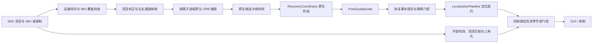

# VIO 门控及性能审计：初步证据

状态：进行中。本文不证明精度或实时性能达标，也不是实机验收。

## 调用链与信任边界

图为主数据流；离线重处理与实时采集的队列和执行时序不同。VIO 灰度输入、手部检测图以及最终显示可能分别执行校正，不能假设其图像坐标或处理线程相同。

实时路径由 `PipelineWorker` 获取帧，`LiveVioRuntime` 对齐 IMU、校正并发送至隔离的 VIO 子进程；原生跟踪与重定位候选检查后，`RecoveryCoordinator` 给出原生阶段报告；`LocalizationPipeline` 执行 `PoseQualityGate`、与子进程提交恢复事务、应用隔离，再发布定位证据；`LiveLocalizationHandJoin` 验证帧绑定、事务和定位准入后才转换世界坐标手部。录制回放走相应的 `ReplayVio` 路径，不能把离线吞吐视为设备实时吞吐。

各层对同一身份及时间戳的检查跨越原生进程、事务和最终消费者，承担不同信任边界；重复计算是否可优化需要测量，不能据此删除任一安全验证。`Tracking OK` 本身不保证准入。IMU 外推明确标注为非视觉位姿；新地图与旧地图的连续性不自动成立。

| 层级 / 输入 | 核查和阈值来源 | 失败与状态影响 | 证据和限制 |
| --- | --- | --- | --- |
| 录制配对 / 双目 SDK 包 | `sdk_recording.iter_paired_frames` 按序号和设备时间配对，维持 HEVC 解码状态 | 不配对的帧不送入后续处理 | 是传输一致性，不证明曝光同步；录制的时间语义仍未由厂商确认 |
| IMU 对齐 / 相机时间与惯性样本 | `imu_lattice` 和 session phase 校验覆盖、时序与相位；恢复预测的 20 ms 缺口、5 ms 端点保持、2 秒时限来自候选 YAML | 不足或无效时明确失败或跳帧；不得以缺失样本伪造连续 IMU | 时间与数值条件是确定性检查；阈值为工程配置，相位一致不等于曝光时刻认证 |
| 原生跟踪 / 校正图与 IMU | ORB 跟踪、局部地图与重定位，短恢复采用候选 DLL | 原生结果可能丢失、重定位或更换参考；Tracking OK 不直接授权输出 | 异步调度及原生 BA 会改变结果；同一输入需要重复，快照读取检查不证明绝对精度 |
| 恢复几何 / 帧绑定观测 | `short_recovery.geometry_candidate`：50 几何内点、30 双目内点、6/12 网格、50% 内点比例、归一化 P95 不大于 3；`geometry_matches_frame` 复核帧及参考 | 不合格几何不能作为同参考隔离释放证据；身份不一致不能沿用旧参考 | 数量及残差门槛为经验值，身份绑定为确定性约束；高内点数不能排除退化或错误地图 |
| IMU 恢复一致性 / 锚点、IMU 与候选体位姿 | `LossRecoveryPredictor` 积分并以候选 YAML 的时间增长包络比较 | 不一致可拒绝候选或触发隔离；不可用时具体结果取决于恢复路径，几何释放路径并非一律拒绝 | 非协方差统计门控；短预测用于证据而非视觉位姿；实际误差与 bias 尚无充分真值标定 |
| 应用质量 / 快照、身份、跟踪、位姿、时间 | `PoseQualityGate` 检查刚体、递增时间、身份、IMU 或经验证双目启动及运动步长，`configs/vio/live_quality.yaml` 配 1.5 秒稳定窗口 | 拒绝时清除输出；跟踪丢失、身份或运动异常等会重置稳定历史，正常等待稳定则继续累计；已准入参考上的异常跳变反馈协调器并隔离 | 物理速度加噪声余量是经验门槛；快速真实运动可误拒，时间步长影响等效速度 |
| 事务与隔离 / native 报告和质量反馈 | `recovery_contract` 绑定会话、帧序、时间、地图和阶段；`RecoveryCoordinator` 管理隔离及候选配置超时 | 身份或事务错误拒绝；隔离不发布旧地图；配置为独立新图时超时请求新图 | 与应用质量有重复身份校验，但位于不同进程信任边界；新图不自动与旧图拼接 |
| 世界手部 / 已准入位姿、逐帧手部和标定 | `consumer_map_pose`、`live_hand_join` 与录制绑定验证会话、时间、标定、事务及坐标契约 | 未通过则世界坐标不可用，保留相机坐标；不同 segment 不授权合并 | 本地代数回算可发现绑定/变换不一致，无法证明手部或位姿的绝对准确性 |

该表是当前代码路径的概览，不是所有输入异常或所有原生写入并发的形式化证明；各项仍需在不同遮挡、运动和纹理场景做覆盖。

应用质量门控检查跟踪状态、原生快照、地图和参考身份、时间戳、IMU 准备、刚体合法性、运动突变和连续稳定窗口；失败会抑制位姿，突变反馈可触发隔离。恢复协调器对已隔离旧地图要求同参考帧绑定几何证据或独立新地图。当前短恢复实现中，几何合格且 IMU 检查为 `unavailable` 时也可能解除隔离（仅明确 `inconsistent` 被禁止）；这属于既有策略，不能据此声称错误恢复风险已验证。新地图不会自动拼接旧世界坐标。

## 参数风险

- 质量门控平移限制为 `0.02 + 1.5*dt` 米，角度限制为 `3 + 360*dt` 度。噪声余量使等效速度限制随时间步长改变，较快真实运动可能误拒。历史 EuRoC 真值审计 `handoff/vio_recovery_gt_20261113/unmasked_step_gt_audit.json` 记录了 50 ms 真值位移超过 0.095 m 限制的帧；这说明存在误拒风险，不证明放宽阈值安全。
- 同图恢复几何要求内点数、双目内点、网格覆盖、比例及归一化残差，并严格绑定帧和参考身份；这些经验阈值并不证明退化场景下的绝对精度。
- IMU 经验包络在 0.5、1、2 秒分别为位置 0.55、1.30、4.30 m，角度 70、115、205 度。它不是经标定的协方差或置信区间；目前没有证据支持把其替换成统计检验，也不能据此认证错误恢复率。
- 1.5 秒稳定窗口是应用门控，3 秒隔离超时只在配置相应动作时请求独立新地图；2 秒预测上限、20 ms 最大 IMU 间隙及最多 5 ms 端点保持属于不同约束，不能相加视为必然等待。是否存在可安全合并的串行稳定窗口尚需帧绑定事件证据。

## 已有离线样本

`results/vio_repair_184714_20261114` 的 poses-only 单次回放处理 3283 帧，2811 帧准入。用 `scripts/audit_replay_gates.py` 可复算：跟踪不可用 100 帧、等待 IMU 初始化 280 帧、等待稳定窗口 92 帧；隔离原因 `reference_frame_unverified` 3 帧。原因计数是每帧质量门控的首个原因，不代表完整的并行阻塞原因或独立恢复事件。该次结果未记录合格 visual release，因此无法证明几何恢复到最终准入的延迟。

同次 3283 条 `ipc_track_ms`：平均 74.23 ms，中位数 73.70 ms，P95 87.36 ms，P99 91.91 ms，最大 142.99 ms。此值包含 IPC 与原生跟踪，不可归因于单一阶段，也不是采集到显示的延迟。回放总耗时 345.295 秒，离线处理约 9.51 帧/秒；不等于实机采集 FPS。结果目录记录了输入哈希及配置快照，不能用本次单次运行替代固定输入重复分布。

另用 `scripts/benchmark_recorded_pipeline.py --recovery-v4` 在同一录制上运行三次 120 帧手部加 VIO 的有界回放（主动停止，replay 状态为 cancelled，不能当作完整会话）；处理帧到达间隔换算分别为 7.38、6.75、7.23 FPS，手部处理计时中位数分别为 23.16、24.70、24.93 ms，P95 分别为 34.80、55.95、41.13 ms。首次启用 cProfile，另两次未启用，不能直接用首次作为性能对照。后两次输入和候选 DLL 哈希一致；最后一次前后输入哈希一致，第一次重复只记录了执行后哈希。诊断输出分别位于 `results/audit_v4_pipeline_20261114`、`results/audit_v4_pipeline_repeat1_20261114` 和 `results/audit_v4_pipeline_repeat2_20261114`。这些是 GUI worker 无渲染的离线数据，不是采集、GUI 绘制或曝光延迟，也不能代表长时间稳定性。

首次剖析观察到时序准备和子进程收包等待；该统计并未覆盖原生子进程内部或完整线程，累计时间不能直接视为 CPU 使用时间或独立阶段耗时。时序准备会独立验证录制相位，不能直接去掉以缩短初始化。

## 已实施：减少离线时序准备的无用图像转换

时序核验只使用偶数索引配对帧；配对器现在仍按原顺序解码全部 HEVC 包，但跳过其余配对帧的 BGR 转换。抽样索引、时间戳和校验逻辑不变。使用 184714 的前 136 对选中帧，三组交替执行的完整图像字节及身份哈希一致；旧路径耗时 6.39、5.86、5.71 秒，新路径 5.89、5.48、5.42 秒（包含哈希开销，结果 `results/phase_decode_ab_20261114.json`）。这是解码及图像转换局部测量，不代表整机加速比例。

修改后客户候选配置的 120 帧有界回放 `results/audit_v4_phase_stride_20261114` 成功运行；与 `audit_v4_pipeline_repeat2_20261114` 比较，完整时序验证结果逐字段相同，确认时刻相同，均为 52 ms；输入文件运行前后哈希一致。异步跟踪可能改变逐帧结果，不能把这次一致的相位验证当作绝对轨迹精度或长时间稳定性证明。未更改相位质量要求、恢复门控、原生 DLL 或设备处理路径。

自动化回归：完整 `pytest -q` 为 943 通过、1 跳过；新增测试验证每个 HEVC 包仍被解码，而只有选中的配对帧转换为 BGR。自动化回归不替代真值精度验证。

进一步检查有手数据的剖析发现：时序准备 `image_scale=1.0` 时，灰度转换后仍执行同尺寸 `cv2.resize`。已去掉这个恒等缩放；其他比例继续执行原来的缩放。对 184714 无手与 111807 有手录制分别重复两次、每次 60 对图，修改前后灰度图逐像素一致；局部转换旧路径平均 2.16–2.65 ms/对，新路径 0.67–0.94 ms/对，测量不含其他阶段。两个录制分别重新运行完整独立相位核验：配置哈希、核验结果所有字段和确认时刻与修改前一致，仍分别为 52 ms、106 ms；输入哈希前后相同。实测见 `results/phase_gray_{empty,hand}_repeat{1,2}_20261114.json` 与 `results/phase_preparation_no_identity_resize_{empty,hand}_20261114`。回放、配对和时序相关测试 54 项通过；该优化不改变相位验证规则，也不证明 VIO 的绝对精度或实时吞吐改善。

优化后又对上述两段分别进行 120 帧 v4 离线重处理（目录 `results/v4_no_identity_resize_empty_20261114`、`results/v4_no_identity_resize_hand_20261114`），输入哈希前后相同，均按计划完成后主动取消，相位仍为 52 / 106 ms。两段分别有 8 / 71 帧准入，全部标为 `stereo_bootstrap`；世界手部契约审计无错误，其中有手段复核 1491 个有效世界关节。异步跟踪可能改变结果，120 帧不能证明长时间稳定或物理精度不退化。

本次恒等缩放优化后完整 `pytest -q` 结果为 954 通过、1 跳过、2 个第三方弃用警告；测试不替代 VS030 物理真值或实机验收。

## 离线校正映射候选：未保留

离线 VIO 原来使用浮点校正映射，实时 VIO 的 `StereoRectifier.remap_pair` 使用预转换映射。`scripts/benchmark_vio_remap.py` 对 184714 前 60 对真实画面做两次交替测量，120 张图在两种映射下逐像素相同；两次双目局部平均耗时分别为浮点 5.07 / 4.78 ms、预转换 4.56 / 4.31 ms（24 个 OpenCV 线程）。针孔及鱼眼的非零畸变合成图也做了逐像素回归。这些仅覆盖局部映射，不证明所有平台和输入都相同，也不证明整机加速。

实际 120 帧 v4 离线完整处理的两次候选运行分别约 5.01、5.08 FPS，随后的原路径运行约 7.70 FPS；先前原路径运行约 7.71 FPS。候选和随后对照输入前后哈希一致，时序均验证为 52 ms，120 帧均处理完后主动取消。系统负载、线程调度、内存峰值等尚未隔离，无法确定变慢的原因或做统计因果归因；但由于这两次完整运行并未显示整体改善，候选回放代码已撤回。测量保留在 `results/vio_remap_compare_184714_20261114.json`、`results/vio_remap_compare_repeat2_184714_20261114.json`，以及 `results/audit_v4_fixed_remap_20261114`、`results/audit_v4_fixed_remap_repeat2_20261114`、`results/audit_v4_float_remap_control_20261114`。

在另一份 120 帧原路径记录 `results/audit_v4_phase_stride_20261114` 中，左右检测计时平均为 18.97 / 21.29 ms，P95 为 28.88 / 30.00 ms；匹配与三角化平均 0.012 ms。该段没有检测到手，三角化计时为零，不可用于评价有手时的计算成本；左右检测可能并行，其耗时不能相加当成端到端延迟。

## 有手录制的离线工作进程剖析

在 `data/hand/session_20261110_111807_489019700` 前 120 帧，使用 v4 候选配置进行有界重处理；`results/hand_111807_v4_perf_20261114` 记录了输入前后哈希、模型和候选库配置。120 帧左右检测均有手，均有有效三维关节点。手部引擎（不包括独立 VIO、采集、GUI 绘制和结果写盘）平均 44.70 ms、P50 42.36 ms、P95 56.14 ms、P99 61.09 ms；左右检测分别平均 31.98 / 37.50 ms、P95 37.80 / 48.26 ms；匹配与三角化合计平均 2.12 ms、P95 2.71 ms。两侧检测可以并行，不能把它们简单相加。该片段无外部手部真值，检测和关节点数不证明正确性；`scripts/audit_hand_timings.py` 按输出类别统计且记录空样本，详细结果在 `hand_stage_timings.json`。输入时间语义、实机曝光延迟及设备 FPS 仍未验证。

用同一片段及模型，按 1、4、24、1、4 个 OpenCV 线程依次运行工作进程，每次 120 帧，实际执行速率分别为 6.15、7.40、7.56、5.94、7.24 FPS；引擎 P50 分别为 48.13、37.41、35.05、52.40、37.88 ms。五次输入哈希、模型和配置哈希一致，均有 120 帧有效三维关节、共 2520 个，按手标签、track ID 和关节 ID 匹配后相机坐标逐项相同；均有 71 帧位姿准入和 71 帧世界手部可用。共同准入帧的 VIO 矩阵相对于 24 线程运行仍有最大元素差约 0.00196，可能受异步调度等影响，不能把关节数或矩阵差当作绝对精度验证。24 线程仅一次、4 线程两次，差异未证明在多设备和长时运行下稳定；1 线程在该片段较慢。未更改 GUI 的线程默认值。

这五次的 120 帧均未完成 IMU 初始化；71 帧准入位姿的来源均标记为 `stereo_bootstrap`，不能当作已初始化的惯性 VIO 结果。上述结果位于 `results/hand_111807_cv{1,4,24}_repeat{1,2}_20261114` 对应目录（24 线程仅 repeat1）；`benchmark_recorded_pipeline.py --opencv-threads` 只设置实验进程内的 OpenCV 线程，不设置独立 VIO 子进程的线程。

同一有手录制继续运行两次各 500 帧，输出分别在 `results/hand_111807_v4_long500_repeat1_20261114`、`results/hand_111807_v4_long500_repeat2_20261114`。每次输入前后哈希一致、工作进程正常处理 500 帧后主动取消，离线处理速率 7.35 / 7.30 FPS；500 帧中 497 帧有有效三维关节，448 帧世界手部可用、49 帧不可用、3 帧无有效手部关节。两次 VIO 各有 451 帧准入，全部标记 `stereo_bootstrap`，IMU 初始化数均为 0，不能称为惯性定位完成。手部引擎 P95 为 45.73 / 46.19 ms，有效三维帧的匹配与三角化 P95 为 1.97 / 2.13 ms；各阶段完整统计保存在各目录 `hand_stage_timings.json`。

基准每约 30 帧采样工作进程及当时可见的子进程，共 17 次；两轮 RSS 合计从首样本约 1168.6 / 1167.6 MiB 增至末样本约 1295.4 / 1293.4 MiB，采样最大线程总数 194 / 195。RSS 可含共享内存，不能当作独占内存；采样未覆盖所有峰值，也未测 GPU。首末样本中同 PID 进程的 CPU 时间增量除以墙钟间隔约为 3.02 / 2.99 个逻辑核，排除短暂出现并退出的进程，不能当作机器总 CPU 或完整任务资源。只有约 500 帧，内存增长不能定性为泄漏或证明长期稳定，需更长时间及进程生命周期测量。

### 第二段有手录制的参考变化

`data/hand/session_20261110_111833_589265500` 先运行 500 帧，随后独立运行 1200 帧覆盖历史参考变化。长段处理完后主动取消，输入前后哈希一致，离线处理约 6.52 FPS；时序相位验证为 106 ms。1200 帧中 1122 帧有有效三维关节，手部引擎 P95 为 52.39 ms。位姿 1035 帧准入且全部为 `stereo_bootstrap`；虽然末段 117 帧原生报告 IMU 已初始化，本次没有已准入的惯性位姿，不能当作惯性 VIO 验收。

这一单次运行中，第 1083–1085 帧参考代次依次变化，质量门控重新等待；第 1120 帧失跟，第 1121 帧跟踪恢复但因无可信惯性锚点进入 `direct_recovery_unavailable` 隔离；第 1166–1197 帧质量门控虽通过，隔离仍阻止位姿输出；第 1198 帧报告位姿突变，隔离原因改为 `pose_jump`。第 1199 帧隔离约 2.6 秒，尚未达到配置的 3 秒超时；本次在第 1200 帧主动结束，不能推断超时后的新地图行为，也不能证明该次跳变的物理真伪。

`scripts/audit_recorded_world_hands.py` 对保存的 1200 帧输出复核了同帧恢复事务、质量/隔离准入、参考身份、分段不合并标志及逐关节坐标变换。1005 帧世界手部状态为 available、165 帧 unavailable、30 帧无有效手部关节；共检查 20996 个有效世界关节，最大代数差约 1.15e-16 m，没有报告违反已检查契约。审计使用与生产相同的位姿消费者校验，且没有外部真值，不能证明坐标绝对精度、双目曝光同步或跨地图连续。输出见 `results/hand_111833_v4_long1200_20261114/world_contract_audit_v2.json`；早期 500 帧审计的第一版误将全无效空骨架当作违规，保留在结果目录，修正版本为 `world_contract_audit_v2.json`。

长段的 41 次资源样本中，工作进程及可见子进程 RSS 合计从约 1169.0 MiB 增至 1400.8 MiB，采样最大线程合计 193。RSS 包含可能共享的页面，峰值可能未被采样；约 1200 帧不能判定是否泄漏或长期稳定。

随后独立运行 1320 帧，输出位于 `results/hand_111833_v4_long1320_20261114`，输入前后哈希一致。第 1121 帧再次因无可信锚点进入隔离，第 1191 帧出现 `pose_jump`；第 1211 帧隔离达到 3.0 秒并请求独立新地图，第 1212 帧地图 epoch 从 9 变为 1048585。第 1259 帧新的双目视觉 segment 首次准入，至第 1319 帧保持准入。旧段 ID 为同一定位会话中的 `:0`，新段为 `:1`，新段 `T_session_from_segment` 为 null，跨段合并权限为 false。此次观察支持该次超时触发和新旧段隔离，不证明失跟位姿正确，也不保证其他运行具有相同事件时序。1320 帧中 129 帧报告 IMU 初始化、1096 帧准入全部标为 `stereo_bootstrap`。

该次独立的 `world_contract_audit.json` 检查 23409 个有效世界关节，未发现同帧契约、段身份或坐标变换错误；1066 帧 world available、224 帧 unavailable、30 帧无有效关节。仍仅为内部一致性，不是物理真值或连续性认证。两次长回放中跳变发生的具体帧不同，体现运行间调度变化。

对同一 1320 帧位姿日志再运行 `audit_vio_frame_snapshots.py` 和 `audit_world_frame_changes.py`：1320/1320 帧的 `snapshot_consistent` 与 `snapshot_available` 均为 true，快照审计违规数为 0，原生 raw pose valid 为 1316、应用准入为 1096；以 0.5 m、0.2 s 筛选时没有同段相邻世界坐标跳变候选。固定标定下 body/camera 外参闭合误差统计最大约 0.135 m，但该闭合使用当前录制的候选坐标关系，不能作为绝对精度证据；它只说明日志字段没有触发当前代数检查的矛盾。报告位于 `results/hand_111833_v4_long1320_20261114/snapshot_audit.json` 和 `world_frame_audit/world_frame_changes.json`。

## 尚缺证据

需要用固定输入、配置和 DLL 哈希重复对照，独立测量解码、复制、校正、检测、原生子阶段、队列与 GUI；覆盖恢复事件和 GT，评估误放行、地图身份、世界手部误发布、长运行及资源。当前无充分证据确认精度不退化或安全地缩短门控，不调整准入阈值。已有离线结果不能验收真实设备时间同步或长期稳定性。

## 恢复事件与已有真值对照

`scripts/audit_replay_gates.py` 的事件定义是：已有一次准入后，首次出现 LOST/RECENTLY_LOST 开始观察，直到下一次准入或录制结束；中间可能包含多次原生失跟。它分别保留第一次 Tracking OK、首次已报告的 qualified visual release、最终准入及身份变化，不把 Tracking OK 作为视觉几何认证，也不推断缺失事件。`results/vio_repair_184714_20261114/gate_episode_identity_audit.json` 对 184714 的单次回放识别到一个此定义下的事件：第 141 帧失跟，第 174 帧约 1.10 秒后首次 OK，第 492 帧约 11.70 秒后再次准入。首次 OK 后还有 63 帧 LOST/RECENTLY_LOST；参考身份多次变化，日志未记录 qualified visual release。失跟至重新准入的质量门控首要原因包括 98 帧跟踪不可用、207 帧 IMU 初始化等待、46 帧稳定窗口等待。它不是同地图恢复实验，首次 OK 到准入约 10.60 秒中包含再次失跟和参考变化，不能归因于单个等待门控。

已封存的 `handoff/vio_recovery_gt_20261113/controlled_summary.json` 包含四种遮挡时长的 candidate/control 运行；三个 candidate 运行遮挡前未准入，所有八个运行均没有可比较的同参考恢复事件。部分 candidate 先报告几何有效，后在不同参考身份上才准入，不能把这两个时刻的差值当作同图门控延迟；control 未记录已评估的同参考重新准入。该结果既不证明误恢复增加，也不证明风险不增加。需要可复现的遮挡前准入、同参考证据和足够重复次数，再讨论压缩稳定窗口。

代码顺序还值得专项验证：`LocalizationPipeline.process` 在最终 `apply_recovery_quarantine` 之前调用 `PoseQualityGate.check`。`test_stable_quality_inside_quarantine_cannot_publish_world_pose` 证实：构造的单一协调器场景中，隔离期间质量门控可以通过，但隔离仍阻止地图位姿和世界手部发布。进一步的 `test_geometry_release_after_stable_quarantine_reports_imu_unavailable` 构造同参考几何释放，证实此前稳定窗口已满足、且 IMU 检查不可用时，释放帧会立即准入。累计的是原生报告的帧，不能仅凭 `Tracking OK` 认定之前每帧都已获得独立几何认证。这些是确定性合成合约测试，不证明真实数据存在错误准入或精度安全；需要针对隔离、参考切换和释放进行真值实验，不能简单复用或缩短窗口。

### 当前源码的固定遮挡重复实验

在 EuRoC V1_02_medium 复用原预设计划：第 460–499 帧双目遮挡、共 1000 帧；输入、源码及 DLL 哈希由每次 `plan.json` 和 `run_summary.json` 保存并复核。候选使用短恢复 DLL `d4e3…3158`，恢复配置哈希 `a965…8df2`（原 runner 引用的 v3 YAML 与当前 v4 YAML 内容哈希相同）。公开数据实验使用其自己的相机配置，且设置 `WORLD_FRAME_DISABLE=1`；不能将结果直接当作 VS030 客户默认配置或实机结果。

| 运行 | 遮挡前准入 | 首次 Tracking OK / 首次合格几何（解除遮挡后） | 首次再准入 | 可评估同参考误差 |
| --- | --- | --- | --- | --- |
| candidate 1 | 是 | 0.40 / 0.40 秒 | 8.05 秒，独立参考 | 否 |
| candidate 2 | 是 | 0.40 / 0.40 秒 | 8.05 秒，独立参考 | 否 |
| control 1 | 是 | 约 0.45 秒 / 未记录合格几何 | 记录结束前无 | 否 |
| control 2 | 否 | 约 0.35 秒 / 未记录合格几何 | 记录结束前无 | 否 |

结果分别为 `results/gt_v4_mask40_repeat1_20261114`、`gt_v4_mask40_repeat2_20261114`、`gt_control_mask40_repeat1_20261114`、`gt_control_mask40_repeat2_20261114`。候选首轮第 508 帧虽报告合格几何，直接恢复检查仍因预测区间超过上限而不可用，隔离未释放且稳定窗口仍等待；第 509 帧质量门控报告约 0.099 m 位移突变，隔离原因变为 `pose_jump`；第 568 帧请求独立新地图，第 661 帧在不同参考上准入。两个 candidate 的这些主要时间点相同，但第二次 control 遮挡前已不满足准入前提，不能用于配对结论。以上说明本次存在多种依次或同时的阻断，不证明放宽任一门控安全；没有同参考 GT 误差，无法认证错误恢复风险不增加。

### 0.2 秒遮挡的同参考回放

沿用同一输入与第 460 帧起始，只遮挡四帧，并按 candidate、control、candidate、control 依次运行，每次 1000 帧。四次遮挡前均已准入。候选两次均在遮挡结束的第 464 帧报告原生 OK，第 465 帧取得与遮挡前相同参考的合格几何并解除隔离，第 494 帧（解除遮挡后 1.50 秒）由稳定门控准入；即几何释放到准入约 1.45 秒。控制组两次均未在记录结束前重新准入，故没有可比较的控制组同参考误差，不能据此推算误恢复率。

候选两次首次准入时，以遮挡前最后可信帧为起点、未经遮挡后重新拟合的 GT 相对运动误差分别为 0.0801 / 0.0720 m、0.182 / 0.099 度；准入后 1 秒内 21 个可比较帧的最大平移误差分别为 0.1349 / 0.1177 m。两个运行都没有超出实验预先声明的 0.15 m / 5 度阈值；这只是单一序列的两个样本。结果分别位于 `results/gt_candidate_mask4_repeat1_20261114`、`gt_candidate_mask4_repeat2_20261114`、`gt_control_mask4_repeat1_20261114` 和 `gt_control_mask4_repeat2_20261114`。

用 `scripts/audit_recovery_shadow_gt.py` 在估计结束后独立回看保存的原生快照：第 465 帧相对于遮挡前可信帧的 GT 平移误差两次均约 0.0062 m。脚本校验源记录、GT 哈希，并将首次实际准入误差与独立正式评分器交叉核对。此影子分析不改变任何准入，且提前输出可能改变后续锚点及跟踪调度，不能将原轨迹直接当作更短门控策略的实际结果；同样不能用两个样本证明错误准入风险不增加。门控参数保持不变。
